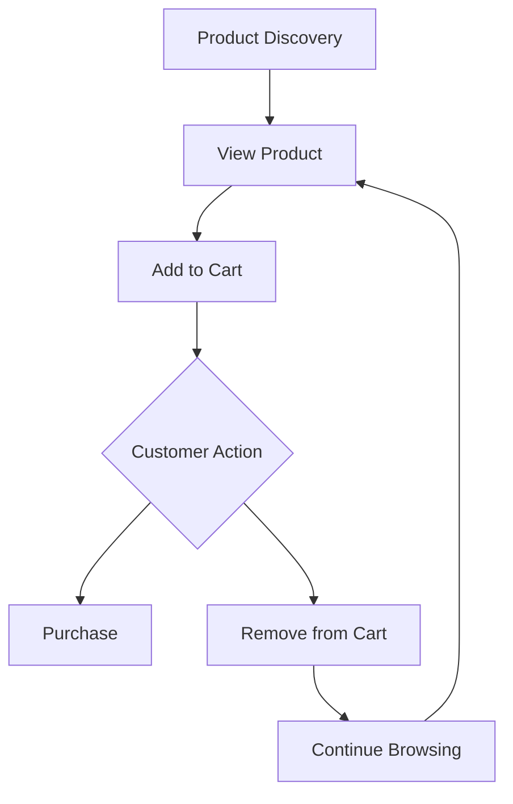
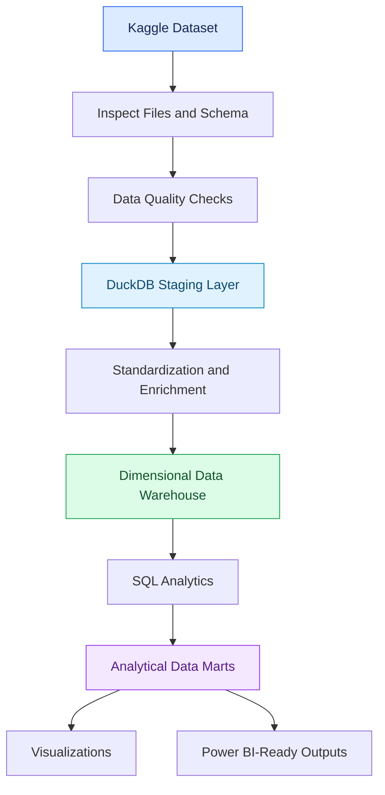
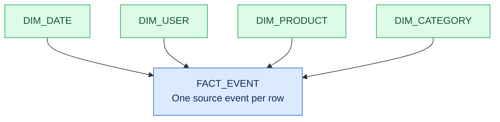

<!-- ===================== HEADER ===================== -->

<h1 align="center">🛒 E-Commerce Data Warehouse & Analytics</h1>

<p align="center">
  <strong>From Raw Shopping Events to Business Intelligence</strong>
  <br>
  A large-scale e-commerce analytics and data modeling project built in Kaggle.
</p>

<p align="center">
  
  
  
  
  
</p>

<p align="center">
  <a href="https://www.kaggle.com/datasets/mkechinov/ecommerce-behavior-data-from-multi-category-store">
    📊 Explore the Dataset
  </a>
  &nbsp; • &nbsp;
  <a href="#-data-architecture">Architecture</a>
  &nbsp; • &nbsp;
  <a href="#-analytics-roadmap">Analytics</a>
  &nbsp; • &nbsp;
  <a href="#-development-progress">Progress</a>
</p>

---

## 📌 Overview

This project aims to build an end-to-end analytical system using real-world e-commerce behavioral data.

Rather than stopping at exploratory data analysis and charts, the project follows a structured workflow:

**Raw Data → Data Quality → Transformation → Data Warehouse → SQL Analytics → Business Insights**

Development takes place in **Kaggle Notebooks**, using Python, SQL, DuckDB and Parquet.

### 🎯 Project Goals

| Workstream | Objective |
|---|---|
| Data Engineering | Ingest, transform and validate large datasets |
| SQL Analytics | Build efficient analytical queries |
| Data Modeling | Design fact tables, dimensions and a star schema |
| Business Analytics | Measure revenue, conversion and product performance |
| Customer Analytics | Explore RFM, cohorts and retention |
| Data Quality | Validate data, keys and transformations |
| Visualization | Create charts and reporting-ready outputs |

> 🚧 **Current status:** Work in progress. Planned features are not claimed to be completed or production-tested.

---

## 📊 Dataset

### eCommerce Behavior Data from Multi-Category Store

**Source:** [Open the dataset on Kaggle](https://www.kaggle.com/datasets/mkechinov/ecommerce-behavior-data-from-multi-category-store)

The dataset contains event-level online shopping behavior, including product views, cart activity and purchases.

### Dataset Schema

| Column | Description | Analytical Use |
|---|---|---|
| `event_time` | Event timestamp | Time-series analysis |
| `event_type` | Type of event | Funnel analysis |
| `product_id` | Product identifier | Product performance |
| `category_id` | Category identifier | Category analysis |
| `category_code` | Product category code | Category reporting |
| `brand` | Brand name | Brand performance |
| `price` | Recorded product price | Purchase-value analysis |
| `user_id` | User identifier | Customer analysis |
| `user_session` | Session identifier | Session analysis |

### 🛍️ Customer Event Journey



**Data scale:** The complete dataset is large. The exact attached Kaggle files and schemas will be inspected before processing. DuckDB will be used to avoid unnecessarily loading the entire dataset into Pandas memory.

---

## 🏗️ Data Architecture

The intended architecture separates ingestion, transformation, warehousing and business analytics.



### Architecture Layers

| Layer | Responsibility |
|---|---|
| Source | Kaggle dataset files |
| Staging | Standardize names, data types and formats |
| Enrichment | Derive useful analytical attributes |
| Warehouse | Store fact and dimension tables |
| Analytics | Calculate business metrics with SQL |
| Data Marts | Create focused customer, product and KPI datasets |
| Reporting | Produce visualizations and Power BI-ready outputs |

---

## 🧱 Data Modeling

The initial design uses a **star schema**, subject to validation against the source data.

### What is a Star Schema?

- **Fact table:** Stores business events and measurable values.
- **Dimension table:** Describes entities used to filter and group facts.
- **Grain:** Defines precisely what one row represents.
- **Surrogate key:** A warehouse-generated identifier for a dimension record.

### Proposed Dimensional Model



### Planned Tables

| Table | Grain | Purpose |
|---|---|---|
| `fact_event` | One source event per row | Event-level analysis |
| `dim_date` | One row per calendar date | Calendar analysis |
| `dim_user` | One row per user identifier | Customer analysis |
| `dim_product` | One row per product identifier | Product analysis |
| `dim_category` | One row per category identifier | Category analysis |

The final model may change if data profiling reveals additional entities, key-quality problems or relationships that require a different design.

---

## 🛠️ Technology Stack

<p>
  
  
  
  
  
  
  
  
</p>

| Technology | Role |
|---|---|
| Python | Processing and analytical workflows |
| SQL | Transformation, aggregation and analysis |
| DuckDB | Analytical query engine |
| Pandas | Smaller analytical datasets |
| NumPy | Numerical operations |
| PyArrow / Parquet | Columnar storage and data exchange |
| Matplotlib / Seaborn | Visualization |
| Kaggle Notebooks | Development environment |
| Power BI | Planned reporting and dashboard layer |

---

## 📈 Analytics Roadmap

### 01 · Executive KPIs

- Total events, users and sessions
- Purchase-event counts
- Purchase-value metrics
- Conversion rates with explicit denominators
- Daily, weekly and monthly trends

### 02 · Revenue and Time-Series Analysis

- Revenue trends
- Month-over-month changes
- Performance by category, brand and product
- Temporal patterns in shopping activity

### 03 · Product and Category Analytics

- Most-viewed products
- Most-purchased products
- Product and category performance
- High-view / low-purchase products
- Brand-level comparisons

### 04 · Funnel Analysis

```text
VIEW
  |
  v
CART
  |
  v
PURCHASE
```

Planned metrics:

- View-to-cart conversion
- Cart-to-purchase conversion
- View-to-purchase conversion
- Funnel drop-off
- Funnel comparisons by product and category

Event counts, distinct users and distinct sessions will be analyzed separately.

### 05 · Customer Analytics

- Customer activity
- Observed purchase value
- Purchase frequency and recency
- New versus returning users
- Customer-level summaries

### 06 · RFM Segmentation

| Metric | Meaning |
|---|---|
| **Recency** | Time since the last observed purchase |
| **Frequency** | Number of observed purchase occasions |
| **Monetary** | Observed purchase value |

Potential segments include Champions, Loyal Customers, Recent Customers, At-Risk Customers and Inactive Customers.

Segment definitions will be documented and validated against the observed data.

### 07 · Cohort and Retention Analysis

- First-purchase cohorts
- Monthly repeat purchasing
- Cohort retention matrix
- Customer activity over time
- Cohort-level purchase-value analysis

---

## 🧪 Data Quality and Validation

Planned checks include:

- Missing-value profiling
- Duplicate detection
- Data-type validation
- Timestamp parsing checks
- Invalid event-type checks
- Price and identifier validation
- Dimension-key uniqueness
- Referential integrity
- Orphan-record detection
- Fact-table row-count reconciliation
- Source-to-warehouse validation

Cleaning rules and exclusions will be documented rather than silently dropping records.

---

## ⚠️ Analytical Assumptions and Limitations

<details>
<summary><strong>Order identification</strong></summary>

The dataset does not provide a conventional explicit order ID. A session identifier must not automatically be treated as a true order ID without validating the source semantics. Any session-based order proxy will be documented as an assumption.
</details>

<details>
<summary><strong>Purchase value and revenue</strong></summary>

The `price` field is a recorded product price. Summing it across purchase events may not represent definitive order-line revenue or total order value in every context. Metrics will be explicitly defined, and possible double counting will be checked.
</details>

<details>
<summary><strong>Funnel definitions</strong></summary>

Event counts, distinct users and distinct sessions represent different measures. Each funnel metric must specify its unit, denominator and observation window.
</details>

<details>
<summary><strong>Customer identity</strong></summary>

User identifiers may not represent complete real-world customer identities. Missing identifiers and tracking limitations will be considered in customer-level analysis.
</details>

<details>
<summary><strong>Processing constraints</strong></summary>

The processing strategy will depend on the files attached to the Kaggle notebook and the available memory and execution limits. The project will not assume that all records can safely fit in memory.
</details>

---

## 📁 Repository Structure

```text
ecommerce-data-warehouse/
│
├── README.md
│
├── notebooks/
│   ├── 01_data_ingestion.ipynb
│   ├── 02_data_quality.ipynb
│   ├── 03_eda.ipynb
│   ├── 04_business_analysis.ipynb
│   ├── 05_customer_analytics.ipynb
│   ├── 06_product_analytics.ipynb
│   ├── 07_funnel_analysis.ipynb
│   ├── 08_rfm_analysis.ipynb
│   └── 09_cohort_analysis.ipynb
│
├── sql/
│   ├── staging.sql
│   ├── dimensions.sql
│   ├── facts.sql
│   ├── data_quality.sql
│   └── analytics.sql
│
├── src/
│   ├── ingestion.py
│   ├── cleaning.py
│   └── validation.py
│
├── docs/
│   ├── data_dictionary.md
│   ├── data_model.md
│   └── business_requirements.md
│
├── outputs/
└── powerbi/
```

*This is the planned structure. Files will be added as implementation progresses.*

---

## 🚧 Development Progress

**Current status: Work in progress**

| Workstream | Status |
|---|---|
| Dataset selected | ✅ |
| Initial scope and architecture defined | ✅ |
| Verify attached files and schemas | ⬜ |
| Complete profiling and quality checks | ⬜ |
| Implement and validate warehouse | ⬜ |
| Complete SQL analytics and data marts | ⬜ |
| Customer and product analytics | ⬜ |
| Funnel analysis | ⬜ |
| RFM segmentation | ⬜ |
| Cohort and retention analysis | ⬜ |
| Visualizations and reporting outputs | ⬜ |
| Document verified findings | ⬜ |

> Update the checklist only after the corresponding work has been implemented and checked.

---

## 🎯 Expected Deliverables

- Reproducible Kaggle notebooks
- Data profiling and quality reports
- Documented dimensional model
- DuckDB warehouse tables
- SQL analytics
- Customer and product analytical datasets
- Funnel analysis
- RFM segmentation
- Cohort and retention analysis
- Business KPI summaries
- Visualizations
- Power BI-ready outputs
- Technical documentation
- Evidence-backed business findings and recommendations

---

## 👨‍💻 Author

**Shubham Jha**

*Data Analytics · Python · SQL · Data Modeling · Business Intelligence*

---

<p align="center">
  <strong>Building from raw events to reliable business insights.</strong>
  <br>
  Correctness first. Transparent assumptions. Reproducible analysis.
  <br><br>
  <a href="https://www.kaggle.com/datasets/mkechinov/ecommerce-behavior-data-from-multi-category-store">
    
  </a>
</p>
