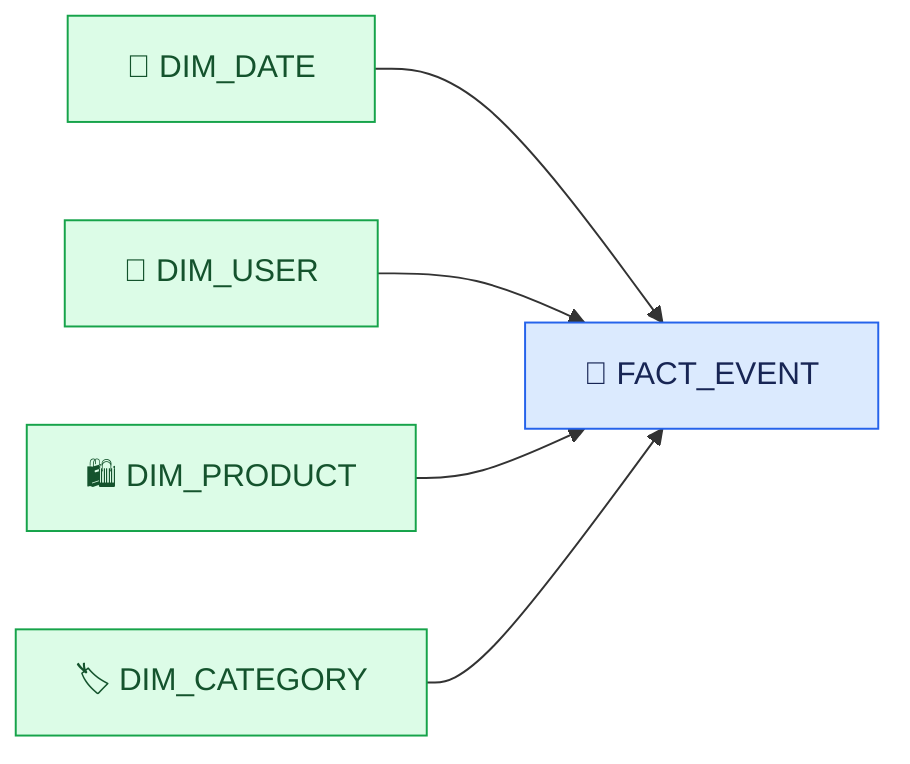
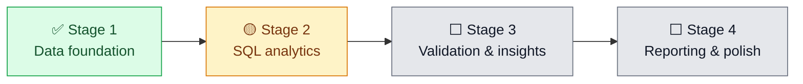

<div align="center">

# 🛒 E-Commerce Data Warehouse & Analytics

### Turning millions of shopping events into decisions a business can actually use.

A hands-on analytics engineering project built in **Kaggle Notebooks** with Python, SQL and DuckDB — using real e-commerce behavior data, not a toy dataset.

[](#-development-status)
[](#-development-status)


[Dataset](https://www.kaggle.com/datasets/mkechinov/ecommerce-behavior-data-from-multi-category-store) · [Architecture](#-the-journey) · [Data model](#-warehouse-design) · [Progress](#-development-status)

</div>

---

## 👋 Why this project exists

A chart can tell us what happened. A well-built data model helps us trust the numbers behind that chart — and explain what they mean.

This project follows e-commerce activity from raw events through a reusable warehouse and into business analysis. The goal is not just to produce attractive dashboards. It is to build a workflow that is **traceable, resource-aware, and honest about what the data can and cannot prove**.

Everything is developed in **Kaggle Notebooks**. The workflow is designed around DuckDB so large event data can be queried without pulling the entire dataset into Pandas memory. No paid cloud warehouse is required.

## 🧭 The journey


| Layer | What it does |
|---|---|
| **Source** | Uses the real e-commerce behavior dataset attached to the Kaggle notebook. |
| **Staging & enrichment** | Standardizes fields and prepares data for analysis. |
| **Warehouse** | Organizes events and descriptive entities into fact and dimension tables. |
| **Analytics** | Uses SQL to answer product, customer, funnel and time-based questions. |
| **Reporting** | Produces clear charts and reusable outputs for business intelligence. |

## 📦 Dataset

**eCommerce Behavior Data from Multi-Category Store** — [view dataset on Kaggle](https://www.kaggle.com/datasets/mkechinov/ecommerce-behavior-data-from-multi-category-store).

The data records online shopping events such as product views, cart activity, cart removals and purchases. The principal fields include:

| Field | What it helps investigate |
|---|---|
| `event_time` | Daily and monthly patterns |
| `event_type` | Shopping behavior and funnel stages |
| `product_id` | Product performance |
| `category_id`, `category_code` | Category comparisons |
| `brand` | Brand performance |
| `price` | Recorded price and purchase-event-value analysis |
| `user_id` | Observed user behavior |
| `user_session` | Session-level activity |

The dataset is large, so query design and memory management matter. The project avoids assuming that all source rows can safely fit in memory at once.

## 🏗️ Warehouse design

The intended model is a star schema: a central event fact table connected to descriptive dimensions.



| Table | Intended grain | Purpose |
|---|---|---|
| `fact_event` | One source event per row | Core event-level analysis |
| `dim_date` | One row per calendar date | Calendar grouping and filtering |
| `dim_user` | One row per user identifier | Observed user analysis |
| `dim_product` | One row per product identifier | Product reporting |
| `dim_category` | One row per category identifier | Category reporting |

The fact table has been created in the current notebook workflow. Validation remains important: dimension join keys must be unique, joins must not multiply source rows, and missing dimension keys must be reported rather than silently ignored.

## 🧰 Tools used

<div align="center">


</div>

- **Kaggle Notebooks** — development and execution environment.
- **DuckDB + SQL** — querying, transformations and analytics on large data.
- **Python / Pandas** — orchestration and inspection of manageable result sets.
- **Parquet** — planned efficient storage and exchange format where useful.
- **Matplotlib** — visual summaries of analytical results.
- **Power BI** — optional downstream reporting; it does not run inside Kaggle itself.

## ✅ Development status

### Stage 1 — Data foundation

**Status: Complete as the initial implementation; validation fixes may still be made as issues are discovered.**

- [x] Selected the Kaggle dataset and defined the project scope.
- [x] Established the staging/enrichment workflow.
- [x] Created the initial dimension tables and `fact_event` table in the notebook.
- [x] Began checking warehouse references and table consistency.

### Stage 2 — SQL analytics

**Status: In progress.**

- [ ] Monthly trends and month-over-month comparisons.
- [ ] Product, category and brand rankings.
- [ ] Customer activity summaries.
- [ ] Funnel metrics with explicit denominators.
- [ ] Cohort and retention analysis.
- [ ] Reconciliation and analytical validation.



> The warehouse foundation is in place, but a completed table is not automatically a validated table. The next work includes fixing reference checks, confirming dimension-key uniqueness and reconciling fact counts with the source.

## 📊 Planned business questions

- Which products and categories account for the largest observed purchase-event value?
- How does purchase activity change month to month?
- Where do users drop off between product views, cart activity and purchases?
- Which users return in later months?
- How much of the result is affected by missing IDs, unknown categories or incomplete tracking?

These questions will be answered only after their metric definitions and data-quality checks are explicit.

## ⚠️ Definitions and limitations

<details>
<summary><strong>Purchase-event value is not automatically revenue</strong></summary>

`price` is a recorded product price. Summing prices on purchase events is described as **purchase-event value** unless the source semantics and counting rules establish that it represents revenue. It must not be presented as verified net revenue or order value by default.
</details>

<details>
<summary><strong>No conventional order ID</strong></summary>

The dataset does not provide a conventional explicit order ID. A `user_session` must not automatically be treated as an order. Any proxy must be labeled and justified.
</details>

<details>
<summary><strong>Funnel metrics need a clear denominator</strong></summary>

Event counts, distinct users and distinct sessions are different measures. Every conversion rate should state which unit, observation window and denominator it uses.
</details>

<details>
<summary><strong>Observed activity is not the same as lifetime behavior</strong></summary>

The first event in the dataset is not necessarily a user's signup date, and a return visit is not necessarily a repeat purchase. Cohort definitions will state what is actually being measured.
</details>

<details>
<summary><strong>Large-data and session constraints</strong></summary>

Kaggle sessions have finite memory and temporary storage. Reusable database files or Parquet outputs can reduce repeated processing, but files in `/kaggle/working/` are not guaranteed to survive every session reset unless exported or otherwise persisted.
</details>

## 📁 Planned repository layout

```text
ecommerce-data-warehouse/
├── README.md
├── notebooks/       # Reproducible Kaggle analysis notebooks
├── sql/             # Warehouse and analytical SQL
├── src/             # Reusable processing and validation helpers
├── docs/            # Data dictionary and model documentation
├── outputs/         # Exported summaries and charts
└── powerbi/         # Optional Power BI-ready artifacts
```

This is the target structure; files will be added as the project develops.

## 🎯 Intended deliverables

- Reproducible notebook workflow
- Documented fact and dimension model
- Data-quality and reconciliation checks
- SQL analytics and reusable data marts
- Product, category and customer analysis
- Funnel and cohort analysis
- Clear visualizations and business findings
- Power BI-ready exports where useful

## 👨‍💻 About

**Shubham Jha** · Data Analytics · Python · SQL · Data Modeling · Business Intelligence

I’m building this project to practice the full analytical journey — not just writing queries, but understanding the data, checking the joins, defining metrics carefully and explaining what the results mean.

<div align="center">

**Build carefully. Validate the numbers. Tell the story honestly.**

[](https://www.kaggle.com/datasets/mkechinov/ecommerce-behavior-data-from-multi-category-store)

</div>
